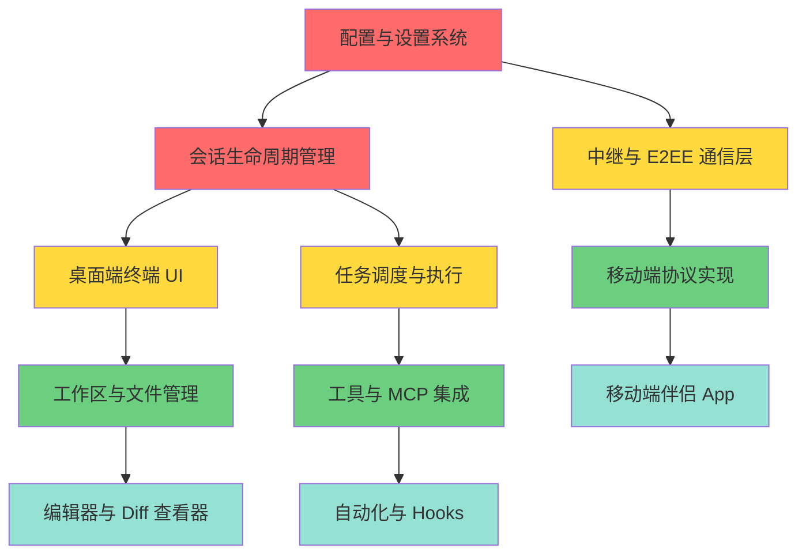

# Orca → Harness 迁移路线图

## 依赖关系图

**图例**：
- 🔴 红色：P0 - 核心基础设施（必须最先完成）
- 🟡 黄色：P1 - 核心功能层（依赖 P0）
- 🟢 绿色：P2 - 扩展功能（依赖 P1）
- 🔵 蓝色：P3 - 高级功能（依赖 P2）

## P0：核心基础设施（必须最先完成）

### 1. 配置与设置系统
**优先级**：🔴 最高  
**依赖**：无  
**预计工作量**：2-3 周

**范围**：
- Orca 的 `orcasettings` 配置文件格式
- 全局配置加载器与验证器
- 配置热重载机制
- 用户/项目/全局三级配置合并逻辑
- 配置迁移工具（从旧版本升级）

**关键文件参考**：
- `src/shared/global-settings-types.ts`
- `src/shared/default-global-settings.ts`
- `src/main/settings/settings-manager.ts`

**完成标准**：
- [ ] 能够加载 Orca 格式的配置文件
- [ ] 配置变更能够触发 Harness 的配置事件
- [ ] 单元测试覆盖率 > 80%
- [ ] 文档：配置项说明和迁移指南

---

### 2. 会话生命周期管理
**优先级**：🔴 最高  
**依赖**：配置系统  
**预计工作量**：3-4 周

**范围**：
- Orca 的 `director.ts`（调度器）→ Harness 的 SessionManager
- Orca 的 `cell.ts`（执行单元）→ Harness 的会话生命周期控制器
- 用 `AbortController` 替代 `process.kill()`
- 会话状态机（创建/运行/暂停/恢复/终止）
- 会话持久化与恢复
- 并发会话管理

**关键文件参考**：
- `src/main/runtime/orca-runtime.ts`
- `src/main/director/director.ts`
- `src/main/cell/cell.ts`

**完成标准**：
- [ ] 能够创建、暂停、恢复、终止 LLM 会话
- [ ] 会话崩溃后能够恢复上下文
- [ ] 支持多会话并发执行
- [ ] 集成测试：模拟 Orca 的会话生命周期场景

---

## P1：核心功能层（依赖 P0）

### 3. 中继与 E2EE 通信层
**优先级**：🟡 高  
**依赖**：配置系统、会话管理  
**预计工作量**：3-4 周

**范围**：
- Orca 的 `mobile-e2ee-v2-contract.ts` 加密协议
- Orca 的 `mobile-relay-phone-protocol.ts` 通信协议
- WebSocket/gRPC 传输层
- 密钥协商与轮换机制
- 设备配对流程

**关键文件参考**：
- `src/shared/mobile-e2ee-v2-contract.ts`
- `src/shared/mobile-relay-phone-protocol.ts`
- `src/relay/protocol.ts`
- `src/main/runtime/rpc/methods/pairing.ts`

**完成标准**：
- [ ] 提取纯规范的加密协议文档
- [ ] Harness 后端实现 E2EE 握手
- [ ] 加密通信可通过单元测试验证
- [ ] 安全审计：密钥管理、重放攻击防护

---

### 4. 桌面端终端 UI
**优先级**：🟡 高  
**依赖**：会话管理  
**预计工作量**：2-3 周

**范围**：
- Orca 的终端交互界面
- 流式输出渲染
- 命令输入与快捷键
- 多终端标签页管理
- 终端主题与字体配置

**关键文件参考**：
- `src/renderer/src/components/terminal-pane/TerminalPane.tsx`
- `src/renderer/src/components/settings/TerminalPane.tsx`

**完成标准**：
- [ ] 能够显示 Harness LLM 的流式输出
- [ ] 支持 Orca 的快捷键映射
- [ ] 终端性能：大量输出不卡顿
- [ ] 可访问性：支持屏幕阅读器

---

### 5. 任务调度与执行
**优先级**：🟡 高  
**依赖**：会话管理  
**预计工作量**：2-3 周

**范围**：
- Orca 的后台任务管理
- 任务队列与优先级
- 任务状态跟踪
- 任务取消与重试
- 任务结果持久化

**关键文件参考**：
- `src/renderer/src/components/settings/TasksPane.tsx`
- `src/main/runtime/task-manager.ts`

**完成标准**：
- [ ] 能够调度 Harness 的异步 LLM 任务
- [ ] 任务失败能够自动重试
- [ ] 任务状态可在 UI 中实时查看
- [ ] 压力测试：100+ 并发任务不崩溃

---

## P2：扩展功能（依赖 P1）

### 6. 移动端协议实现
**优先级**：🟢 中  
**依赖**：中继层  
**预计工作量**：3-4 周

**范围**：
- Orca 移动端的 JSON-RPC 协议
- 移动端特有的 API（触觉反馈、语音输入等）
- 移动端配对与设备管理
- 离线模式与消息队列

**关键文件参考**：
- `mobile/src/home/MobileHomeScreen.tsx`
- `mobile/src/host-screen/HostScreen.tsx`
- `mobile/app/settings.tsx`

**完成标准**：
- [ ] 移动端能够通过中继连接到 Harness
- [ ] 移动端能够发送/接收加密消息
- [ ] 离线消息能够在重连后同步
- [ ] 跨平台测试：iOS + Android

---

### 7. 工作区与文件管理
**优先级**：🟢 中  
**依赖**：桌面端 UI  
**预计工作量**：2-3 周

**范围**：
- Orca 的文件浏览器
- 文件搜索与过滤
- Git 状态集成
- 工作区切换

**关键文件参考**：
- `mobile/src/files/MobileFileExplorerPanel.tsx`
- `src/renderer/src/components/settings/RepositoryPane.tsx`

**完成标准**：
- [ ] 能够浏览 Harness 项目的文件树
- [ ] Git 状态能够实时更新
- [ ] 大型仓库（10k+ 文件）不卡顿

---

### 8. 工具与 MCP 集成
**优先级**：🟢 中  
**依赖**：任务调度  
**预计工作量**：2-3 周

**范围**：
- Orca 的工具调用机制
- MCP（Model Context Protocol）集成
- 自定义工具注册
- 工具权限管理

**关键文件参考**：
- `src/main/runtime/runtime.ts`
- `src/shared/tool-types.ts`

**完成标准**：
- [ ] Harness 能够调用 Orca 定义的工具
- [ ] MCP 工具能够被发现和调用
- [ ] 工具调用有权限校验
- [ ] 工具调用日志完整

---

## P3：高级功能（依赖 P2）

### 9. 移动端伴侣 App
**优先级**：🔵 低  
**依赖**：移动端协议  
**预计工作量**：4-6 周

**范围**：
- 完整的移动端 UI
- 语音输入集成
- 浏览器面板
- 终端面板
- 推送通知

**关键文件参考**：
- `mobile/` 目录下所有文件

**完成标准**：
- [ ] 移动端 App 能够独立运行
- [ ] 所有核心功能在移动端可用
- [ ] 应用商店发布就绪

---

### 10. 编辑器与 Diff 查看器
**优先级**：🔵 低  
**依赖**：工作区管理  
**预计工作量**：2-3 周

**范围**：
- Orca 的代码编辑器
- Diff 对比视图
- 语法高亮
- 代码折叠

**关键文件参考**：
- `src/renderer/src/components/editor/EditorPanel.tsx`
- `src/renderer/src/components/editor/DiffViewer.tsx`

**完成标准**：
- [ ] 能够编辑 Harness 管理的文件
- [ ] Diff 视图能够显示 Git 变更
- [ ] 语法高亮支持主流语言

---

### 11. 自动化与 Hooks
**优先级**：🔵 低  
**依赖**：任务调度、工具集成  
**预计工作量**：2-3 周

**范围**：
- Orca 的自动化规则
- Git Hooks 集成
- 定时任务
- 条件触发器

**关键文件参考**：
- `src/renderer/src/components/automations/AutomationsPage.tsx`
- `src/renderer/src/components/settings/AutomationsSettingsPane.tsx`

**完成标准**：
- [ ] 能够定义自动化规则
- [ ] Git Hooks 能够触发 Harness 任务
- [ ] 定时任务能够按时执行
- [ ] 自动化日志可追溯

---

## 时间线估算

| 阶段 | 子系统 | 预计时间 |
|------|--------|----------|
| P0 | 配置系统 + 会话管理 | 5-7 周 |
| P1 | 中继层 + 桌面 UI + 任务调度 | 7-10 周 |
| P2 | 移动协议 + 工作区 + MCP | 7-10 周 |
| P3 | 移动 App + 编辑器 + 自动化 | 8-12 周 |
| **总计** | | **27-39 周** |

**注**：以上时间为单人全职工作量估算，实际可能因团队规模和并行开发而缩短。

## 里程碑

- **M1（3 个月）**：P0 完成，能够运行基础的 LLM 会话
- **M2（6 个月）**：P1 完成，桌面端核心功能可用
- **M3（9 个月）**：P2 完成，移动端通信建立
- **M4（12 个月）**：P3 完成，完整系统交付

## 下一步行动

1. 从 **P0.1 配置与设置系统** 开始
2. 参考 `examples/01-settings-system/` 案例
3. 使用 `子系统级迁移提示词.md` 进行迁移
4. 完成后更新 PROGRESS.md
